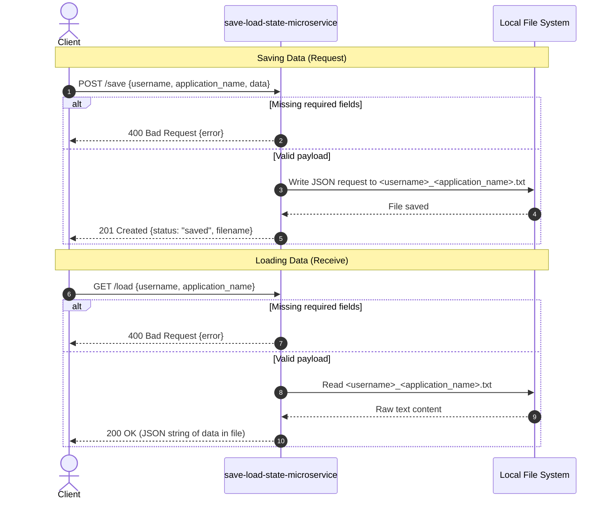

 **SAVE-LOAD-STATE-MICROSERVICE** 

Python microservice that saves and retrieves JSON data to/from local storage using <username_application_name>.txt files.

---

**HOW TO REQUEST DATA (SAVE)**

To store data, send an HTTP POST request to the /save endpoint with a JSON payload containing username, application_name, and data.

Request Parameters:
- username (String, Required): Identifier for the user.
- application_name (String, Required): Identifier for the client application.
- data (Any JSON, Required): The JSON-serializable data to be stored.

Example Request Call:
curl -X POST http://localhost:5000/save -H "Content-Type: application/json" -d '{"username": "jojo", "application_name": "test_app", "data": {"month": "Jan","day": "22", "year": "2026"}}'

Example Response (201 Created):
{"filename": "jojo_test_app.txt", "status": "saved"}

---

**HOW TO RECEIVE DATA (LOAD)**

To retrieve stored data from the microservice, send an HTTP GET request to the /load endpoint with a JSON payload specifying the username and application_name.

Request Parameters:
- username (String, Required): Identifier for the user whose data you want to load.
- application_name (String, Required): Identifier for the application whose data you want to load.

Example Receive Call:
curl -X GET http://localhost:5000/load -H "Content-Type: application/json" -d '{"username": "jojo", "application_name": "test_app"}'

Example Response (200 OK):
{\"month": \"Jan\",\"day"\: 22, \"year"\: 2026}
---

**UML SEQUENCE DIAGRAM**

This sequence diagram shows how a client application interacts with the microservice to save (via request) and load (via response) application data:

